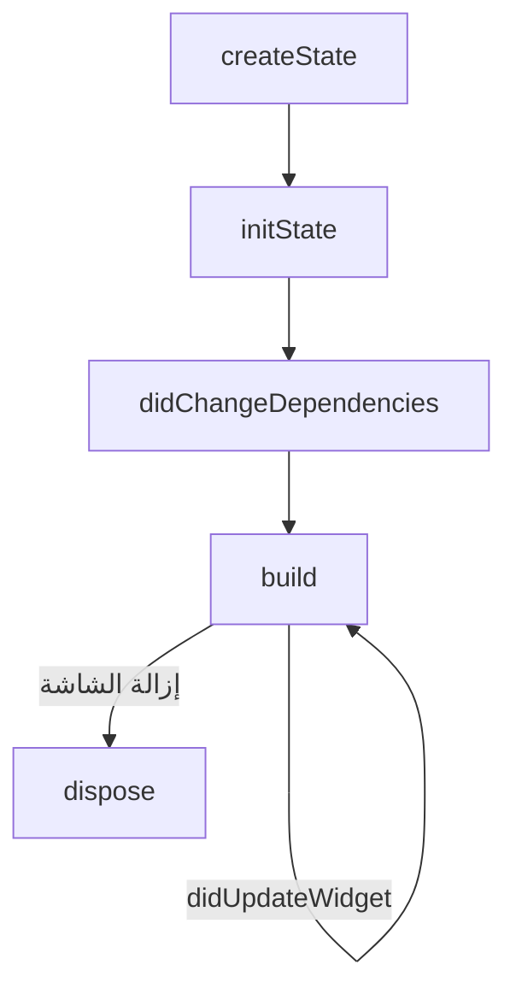
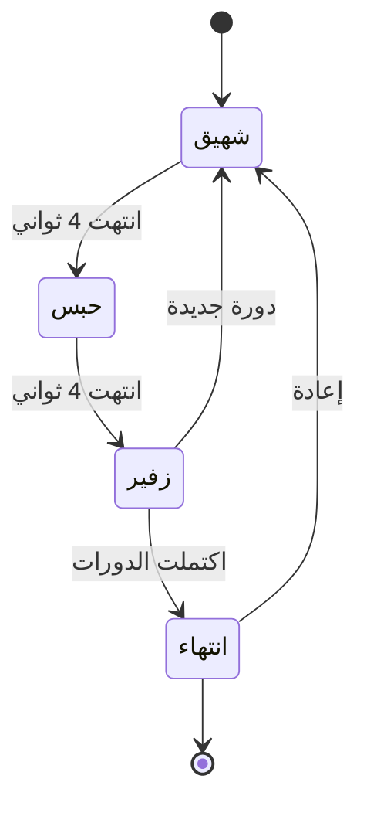

<div dir="rtl">

# تقرير: تمرين التنفس (Breathing Guide)
### تحليل دورة حياة StatefulWidget في Flutter
## 1. مقدمة

تطبيق Flutter لتمرين التنفس الموجّه (شهيق، حبس، زفير)، يعتمد على مؤقت `Timer` ودائرة متحركة `AnimationController`.
اخترت هذه الفكرة لأن حالتها تتغير باستمرار (المرحلة، الثواني، رقم الدورة، حجم الدائرة)، فتوضّح دور الـ `State` ودورة حياته بشكل عملي.

## 2. أهداف التكليف

- [x] بناء شاشة Flutter باستخدام `StatefulWidget`
- [x] تطبيق `initState` لتجهيز الموارد وبدء المؤقت
- [x] تطبيق `dispose` لإيقاف المؤقت وتحرير الموارد
- [x] توثيق الكود وشرح دورة الحياة في تقرير
- [x] رفع المشروع على GitHub وتسليم الرابط

## 3. وصف التطبيق

### الشاشات

| الشاشة | الوظيفة |
|---|---|
| **الشاشة الرئيسية** | تحتوي زر "ابدأ التمرين" للانتقال لشاشة التمرين |
| **شاشة التمرين** | تعرض المرحلة والعدّ التنازلي والدائرة المتحركة والأزرار |

### إعدادات التمرين

| الإعداد | القيمة الافتراضية |
|---|---|
| مدة كل مرحلة | 4 ثواني |
| عدد الدورات | 6 دورات |
| ترتيب المراحل | شهيق، حبس، زفير |

### سلوك الدائرة

| المرحلة | حركة الدائرة |
|---|---|
| شهيق | تكبر تدريجياً |
| حبس | تثبت كبيرة |
| زفير | تصغر تدريجياً |

### الأزرار

| الزر | الوظيفة |
|---|---|
| إيقاف مؤقت / استئناف | تجميد العدّ والأنيميشن ثم المتابعة من نفس النقطة |
| إعادة | يظهر بعد انتهاء التمرين لبدئه من جديد |
| إنهاء | الرجوع للشاشة الرئيسية (يستدعي `dispose`) |

## 4. هيكل المشروع

```text
breathing_guide/
├── lib/
│   └── main.dart        # كامل الكود
├── pubspec.yaml         # أُنشئ تلقائياً بواسطة flutter create
└── README.md            # هذا التقرير
```

الكلاسات داخل `main.dart`:

| الكلاس | النوع | الدور |
|---|---|---|
| `BreathingApp` | StatelessWidget | إعداد التطبيق والثيم واتجاه RTL |
| `HomeScreen` | StatelessWidget | الشاشة الرئيسية |
| `BreathingScreen` | StatefulWidget | شاشة التمرين (تحمل الإعدادات) |
| `_BreathingScreenState` | State | الحالة والمنطق ودورة الحياة |
| `BreathPhase` | enum | المراحل: inhale / hold / exhale |

## 5. دورة حياة StatefulWidget

### التسلسل



### الدوال ودورها في المشروع

| الدالة | وقت الاستدعاء | الاستخدام في المشروع |
|---|---|---|
| `createState()` | عند إنشاء الـ Widget | إنشاء `_BreathingScreenState` |
| `initState()` | مرة واحدة عند دخول الـ State للشجرة | إنشاء `AnimationController` وبدء `Timer` |
| `didChangeDependencies()` | بعد `initState` وعند تغير الـ InheritedWidget | غير مستخدمة |
| `build()` | عند كل `setState` | رسم الواجهة حسب الحالة |
| `didUpdateWidget()` | عند تغير خصائص الـ Widget من الأب | غير مستخدمة |
| `setState()` | عند تغيير البيانات | تحديث الثواني والمرحلة والدورة |
| `dispose()` | عند إزالة الـ State نهائياً | إلغاء المؤقت وتحرير الـ Controller |

## 6. شرح الكود

### 6.1 متغيرات الحالة

| المتغير | النوع | الوظيفة |
|---|---|---|
| `_timer` | `Timer?` | مؤقت يعدّ كل ثانية |
| `_controller` | `AnimationController` | يتحكم بحجم الدائرة |
| `_phase` | `BreathPhase` | المرحلة الحالية |
| `_secondsLeft` | `int` | الثواني المتبقية في المرحلة |
| `_cycle` | `int` | رقم الدورة الحالية |
| `_paused` | `bool` | هل التمرين متوقف مؤقتاً |
| `_finished` | `bool` | هل انتهى التمرين |

### 6.2 دالة initState: التجهيز وبدء المؤقت

```dart
@override
void initState() {
  super.initState();
  _controller = AnimationController(
    vsync: this,
    duration: Duration(seconds: widget.phaseSeconds),
  );
  _secondsLeft = widget.phaseSeconds;
  _startSession(); // يبدأ المؤقت والتمرين تلقائياً
}
```

**لماذا هنا؟** لأنها تُستدعى مرة واحدة فقط عند إنشاء الـ State، فهي المكان الصحيح لإنشاء الـ Controller وبدء المؤقت دون تكرارهما مع كل `build`.
**ملاحظة:** استدعاء `super.initState()` أول سطر إلزامي.

### 6.3 دالة المؤقت والحماية بـ mounted

```dart
_timer = Timer.periodic(const Duration(seconds: 1), _onTick);

void _onTick(Timer timer) {
  if (!mounted || _paused) return; // حماية من setState بعد dispose
  setState(() {
    if (_secondsLeft > 1) {
      _secondsLeft--;
    } else {
      _nextPhase();
    }
  });
}
```

- `mounted` يمنع تحديث واجهة تمت إزالتها.
- قبل إنشاء مؤقت جديد نستدعي `_timer?.cancel()` لضمان عدم تشغيل مؤقتين معاً.

### 6.4 الانتقال بين المراحل



### 6.5 دالة dispose: إيقاف المؤقت وتحرير الموارد

```dart
@override
void dispose() {
  _timer?.cancel();      // إيقاف المؤقت
  _timer = null;
  _controller.dispose(); // تحرير الأنيميشن
  super.dispose();       // يكون آخر سطر
}
```

**متى تُستدعى؟** عند الضغط على "إنهاء" (`Navigator.pop`) وإزالة الشاشة من الشجرة.

## 7. أهمية إلغاء المؤقت في dispose

| بدون إلغاء المؤقت | مع إلغاء المؤقت |
|---|---|
| يستمر `Timer` بالعمل بعد مغادرة الشاشة | يتوقف فوراً |
| تسريب ذاكرة (Memory Leak) لأن المؤقت يحتفظ بمرجع للـ State | يُحرَّر الـ State من الذاكرة |
| قد يظهر الخطأ `setState() called after dispose()` | لا توجد أخطاء |
| استهلاك غير ضروري للمعالج والبطارية | استهلاك صفر بعد الخروج |

وكذلك `AnimationController` يجب التخلص منه لأنه يحتفظ بـ `Ticker` يعمل مع كل إطار.

## 8. طريقة التشغيل

**المتطلبات:** Flutter SDK مثبت، ومحاكي أو جهاز حقيقي.

```bash
flutter create breathing_guide
cd breathing_guide
# استبدل محتوى lib/main.dart بملف المشروع
flutter pub get
flutter run
```

## 9. الاختبار والنتائج

| الاختبار | النتيجة المتوقعة |
|---|---|
| فتح شاشة التمرين | يبدأ المؤقت تلقائياً وتظهر رسالة `initState()` في الـ Console |
| انتظار 4 ثواني | الانتقال من شهيق إلى حبس |
| الضغط على إيقاف مؤقت | يتجمد العدّ والدائرة |
| الضغط على استئناف | المتابعة من نفس النقطة |
| الضغط على إنهاء | الرجوع للرئيسية وظهور رسالة `dispose()` |
| إكمال 6 دورات | ظهور "أحسنت" وزر "إعادة" وإيقاف المؤقت |

## 10. لقطات الشاشة

| الشاشة الرئيسية | شهيق | حبس |
|:---:|:---:|:---:|
| (أضف الصورة) | (أضف الصورة) | (أضف الصورة) |

| زفير | نهاية التمرين | الـ Console |
|:---:|:---:|:---:|
| (أضف الصورة) | (أضف الصورة) | (أضف الصورة) |

## 11. الخلاصة

- `initState` هو مكان تجهيز الموارد وبدء المؤقت لأنه يُستدعى مرة واحدة.
- `build` يعتمد على الحالة ويُعاد استدعاؤه عند كل `setState`.
- `dispose` ضروري لإلغاء المؤقت وتحرير الـ Controller لمنع تسريب الذاكرة.
- استخدام `mounted` يحمي من الأخطاء بعد إزالة الشاشة.

</div>